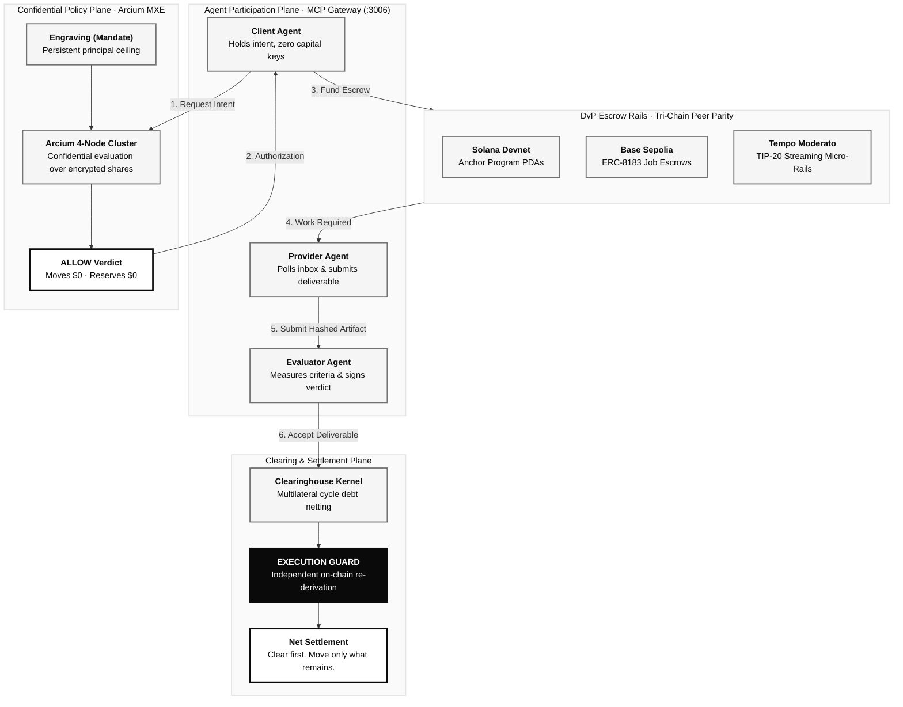
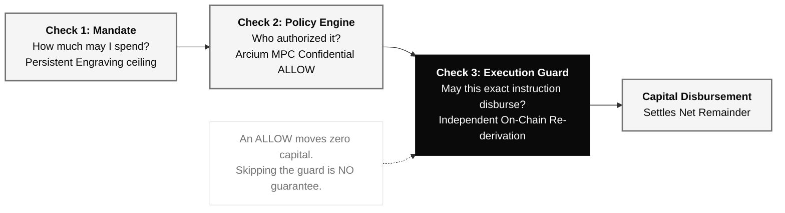

# Mitra

<p align="center">
  <strong>The Financial Coordination Layer and Clearinghouse for Agentic Commerce</strong><br/>
  <em>Mitra lets a business give an AI agent a budget without giving it the keys.</em>
</p>

<p align="center">
  <a href="programs/mitra-vault"></a>
  <a href="docs/portal/14-tempo-substrate.md"></a>
  <a href="contracts/MitraVault.sol"></a>
  <a href="LICENSE"></a>
  <a href="tests/"></a>
  <a href="docs/llms.txt"></a>
</p>

---

## Why Mitra: The Problem

An autonomous AI agent that can spend money is an existential treasury risk. Today, developers face an unacceptable binary choice:

1. **The Custodial Trap (Unbounded Freedom):** Hand the agent naked private keys. If the model hallucinates, suffers a prompt injection attack, or hits an unhandled retry loop, the entire treasury is drained in milliseconds.
2. **The Paralysis Trap (Zero Agency):** Require human approval for every micro-transaction. The agent loses autonomy, high-frequency coordination becomes impossible, and agentic workflows grind to a halt.
3. **The Gross Liquidity Trap:** Existing payment protocols (ERC-20 transfers, Stripe tokens, HTTP 402) move gross capital for every single transaction. In multi-agent economies, moving every leg causes liquidity gridlock, excessive fees, and systemic counterparty risk.

Current payment protocols answer *how* to move tokens from Point A to Point B. They do not answer *whether this exact instruction is permitted to move capital*.

---

## The Solution: Institutional Clearinghouse Architecture

Mitra restores institutional market infrastructure (DTCC, LCH, Euroclear) to autonomous agent commerce: **agents coordinate trade intents, while on-chain vaults and an independent execution guard enforce mathematical spending boundaries.**



---

## The One Mechanism: The Irreversible Boundary



**An `ALLOW` decision is never itself permission to move value.** The policy engine decides whether an action is permitted; the execution guard independently re-derives whether *this exact instruction* may move capital. Neither a human nor an agent can supply their own spend decision.

### Boundary Vocabulary

| Term A | $\neq$ | Term B | Architectural Reality |
|---|---|---|---|
| **`MANDATE`** | $\neq$ | **`RUNTIME FREEDOM`** | A mandate is an immovable ceiling set by human principals. Agents cannot modify their own limits. |
| **`ALLOW`** | $\neq$ | **`DISBURSEMENT`** | An `ALLOW` verdict confirms policy adherence. It moves zero capital and reserves zero tokens. |
| **`INTENT`** | $\neq$ | **`CAPITAL`** | Agents negotiate commercial intents and bilateral agreements. Capital remains locked in programmatic escrows. |
| **`NETTING`** | $\neq$ | **`SETTLEMENT`** | Netting mathematically cancels offsetting obligations across cycles. Settlement is the physical transfer of the remaining balance. |
| **`ENGRAVING`** | $\neq$ | **`AUTHORIZATION`** | An engraving is a persistent budget ceiling. An authorization is a single-use token consumed atomically upon execution. |

---

## The Authority Model: What It Cannot Claim

Following strict institutional assurance, every subsystem has explicit negative boundaries:

| Authority or Surface | Primary Responsibility | What it **cannot** claim |
|---|---|---|
| **Client Agent** | Posts trade intent within principal's mandate | Cannot mint authority, cannot disburse funds directly |
| **Provider Agent** | Executes service, hashes artifacts, submits work | Cannot release escrow, cannot alter payment terms |
| **Evaluator Agent** | Measures deliverable against acceptance criteria | Cannot touch escrowed capital; verdict is purely evidentiary |
| **Policy Engine (Arcium MXE)** | Evaluates rules and confidential limits via MPC | An `ALLOW` cannot disburse capital or skip the execution guard |
| **Execution Guard** | Independently re-derives spend authority on-chain | Cannot fabricate transactions; operates strictly on valid `ACCEPTED` escrows |
| **Clearinghouse Kernel** | Cancels cyclic obligations across epochs | Cannot alter net balances; zero-sum invariant strictly preserved |
| **Operator Console** | Presents audit telemetry, exposure, and headroom | A dashboard display is never on-chain financial authority |

---

## Fewer Payments Move: Multilateral Netting

Where parties owe each other in a cycle, only the net remainder settles.

```
       [Agent A]
      /         ▲
$100 /           \ $40
    ▼             \
[Agent B] ───────► [Agent C]
           $70
```

### The Netting Vector:

| Measure | Amount | Meaning |
|---|---:|---|
| **Gross obligations** | **$210.00** | Finalized reciprocal obligations ($A \to B \$100, B \to C \$70, C \to A \$40$) |
| **Gross movement cleared** | **$150.00** | Circular debt canceled by multilateral cycle netting |
| **Residual net settlement** | **$60.00** | Physical capital moved on-chain (A pays B $30, A pays C $30) |
| **Liquidity compression** | **71.4%** | Capital saved without requiring gross liquidity reserves |

Two hundred and ten dollars of obligation, sixty dollars of movement. The saving grows with the size of the cycle, which is what makes it a network effect rather than a fee.

---

## Live Settlements & Proven Evidence

Every figure this repository reports is read back from the chain or the database *after* the operation, never from the caller's return value (the F86 rule):

| Rail | Substrate | Evidence (Transaction Hash / Slot) | Status |
|---|---|---|:---:|
| **ERC-8183 Escrow** | Base Sepolia | `0x75dbc7429188d30e38a2e1d7cf92f025d57b0fb928` | **LIVE_DEMONSTRATED** |
| **Mitra Vault Program** | Solana Devnet | `jW14aBAbxPfxM7P1yLqL7aF77R4z47W7R4K6r8HWZ` | **LIVE_DEMONSTRATED** |
| **EVM Smart Contracts** | Foundry | 63 / 63 passed (`contracts/MitraVault.sol`) | **TESTED** |
| **Solana Anchor Program** | Rust / Cargo | 147 / 147 passed (`programs/mitra-vault/`) | **TESTED** |
| **Core Kernel & Routes** | Vitest | 1,390 passed, 83 skipped without credentials | **TESTED** |
| **MCP Gateway** | MCP Protocol | 22 tools served, 5 cognitive skills registered | **INTEGRATED** |

Both on-chain transactions are recorded in [`forge/PROOF_LEDGER.md`](forge/PROOF_LEDGER.md). Nothing here is mainnet, and no mainnet funds are claimed.

---

## Run the Autonomous Loop

```bash
# 1. Install dependencies
npm install

# 2. Honest health check (~2s: live chain heads, ports, build state)
npm run doctor

# 3. Start unified daemon stack (Core API :3005, MCP Gateway :3006, Webhook Worker, Keeper)
npm run stack:up

# 4. Run 2 full cycles of the autonomous 3-agent loop
npm run agents:run -- --cycles 2

# 5. Safely terminate background daemons
npm run stack:down
```

`agents:run` starts three distinct agents against the live HTTP API, each holding only the surface its role requires:
- `agent_buyer_live`: reads its mandate, posts the request, opens and funds the agreement.
- `agent_provider_live`: polls its inbox, starts execution, submits the hashed deliverable.
- `agent_evaluator_live`: polls for deliverables, checks acceptance criteria, accepts or rejects.

They are autonomous in the sense that matters: **no step receives the previous step's result.** Each learns what to do by polling its own inbox and signs only its own transitions with real EIP-712 signatures.

---

## Developer Portal & Documentation Manual

- **[16-Page Developer Portal](docs/portal/)** — Complete institutional documentation:
  - [01: What is Mitra? (The Core Thesis & The Custody Trap)](docs/portal/01-what-is-mitra.md)
  - [02: Quickstart: Safe Agent Spend in 5 Minutes (TS & Python)](docs/portal/02-quickstart.md)
  - [03: The Multi-Door Architecture](docs/portal/03-multi-door-architecture.md)
  - [04: Engravings & Mandates: How Principals Bound Authority](docs/portal/04-engravings-and-mandates.md)
  - [05: Confidential Policy Evaluation with Arcium MPC](docs/portal/05-arcium-mpc-confidential-policy.md)
  - [06: The Execution Guard: "ALLOW != DISBURSEMENT"](docs/portal/06-execution-guard-and-allow-invariant.md)
  - [07: Bilateral Agreements & Programmatic DvP Escrow](docs/portal/07-bilateral-agreements-and-escrow.md)
  - [08: Distributed Sagas & Atomic Compensation](docs/portal/08-distributed-sagas-atomic-recovery.md)
  - [09: The Autonomous Keeper Daemon](docs/portal/09-autonomous-keeper-daemon.md)
  - [10: Multilateral Debt Netting: "Clear First. Move Only What Remains"](docs/portal/10-multilateral-debt-netting.md)
  - [11: Epoch Clearing Algorithms & Obligation Reconciliation](docs/portal/11-epoch-clearing-algorithms.md)
  - [12: Solana Substrate: Anchor PDAs, Vaults & Program State](docs/portal/12-solana-substrate.md)
  - [13: Base Substrate: EVM ERC-8183 Escrows](docs/portal/13-base-substrate.md)
  - [14: Tempo Substrate: TIP-20 Streaming Micro-Payments](docs/portal/14-tempo-substrate.md)
  - [15: Model Context Protocol (MCP) Gateway (22 Tools on :3006)](docs/portal/15-mcp-gateway.md)
  - [16: Cognitive Agent Skills & Developer Tooling](docs/portal/16-agent-skills-and-tooling.md)
- **[`/llms.txt`](docs/llms.txt)** — Machine-readable documentation index built natively for LLMs and autonomous agents.
- **[Colosseum Hackathon Submission Dossier](docs/SUBMISSION.md)** — Comprehensive Section 8 rubric mapping with executed evidence.

---

## What We Learned: Boundary Cases & Invariants

Following BUILD_FOUNDRY discipline, defects are recorded rather than papered over:

- **F86 (Reporting After the Fact):** An API response claiming a transaction succeeded is not evidence. Mitra re-reads actual on-chain account balances and store state *after* the operation before reporting success.
- **F79 (Persisted Sagas):** Reconstructing compensation routes in memory after a crash could fabricate refund targets. Mitra writes durable compensation routes to disk before funds move.
- **F100 (Operator-Plane Mandates):** `POST /api/v1/mandates` mints the root of authority. It is narrowed (existence checks, chain approval, first-write-wins) but not yet principal-signed. External agents hold zero mandate-creation verbs over MCP or SDK.
- **F102 (Space Isolation):** `POST /api/v1/spaces` on an existing `spaceId` overwrites budget without ownership checks. The autonomous loop avoids this by strictly owning its own space (`space_live_loop`).
- **F103 (Binary Entrypoint Verification):** The keeper daemon passed typecheck and all 9 unit tests but failed at runtime due to a CJS `await` trap. Running entrypoint binaries (`npm run keeper:once`) is mandatory.

---

## Repository Architecture

```
├── contracts/                   # Solidity smart contracts (ERC-8183 Escrows, MitraClearing)
├── programs/
│   ├── mitra-vault/             # Solana Anchor program (PDA Vaults, Mandates, Escrows)
│   └── arcium-policy-circuit/   # Arcium MPC confidential policy evaluation circuit
├── lib/
│   ├── kernel/                  # Store-free economic kernel & multilateral cycle netting
│   ├── commerce/                # Bilateral agreements, DvP escrows, distributed sagas
│   ├── mcp/                     # 22-tool Model Context Protocol gateway & cognitive prompts
│   └── sdk/                     # Lightweight TypeScript client (@mitra/sdk)
├── skills/                      # 5 cognitive agent playbooks (core, buyer, provider, evaluator, treasury)
├── scripts/
│   ├── doctor.ts                # 2-second honest infrastructure & chain RPC health probe
│   ├── stack.ts                 # Unified background daemon supervisor with PID attribution
│   ├── keeper-daemon.ts         # Autonomous escrow timeout refund sweeper
│   └── run-autonomous-agents.ts # 3-agent continuous loop with real EIP-712 signatures
├── docs/
│   ├── portal/                  # 16-page normative developer documentation manual
│   ├── llms.txt                 # Machine-readable agent index
│   └── SUBMISSION.md            # Colosseum Hackathon Section 8 submission dossier
└── forge/                       # FORGE 1.4 control plane (INVARIANTS, FAILURES, PROOF_LEDGER)
```

---

## License

Released under the [MIT License](LICENSE).