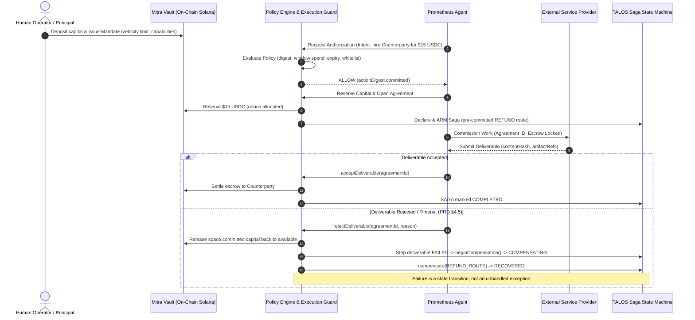
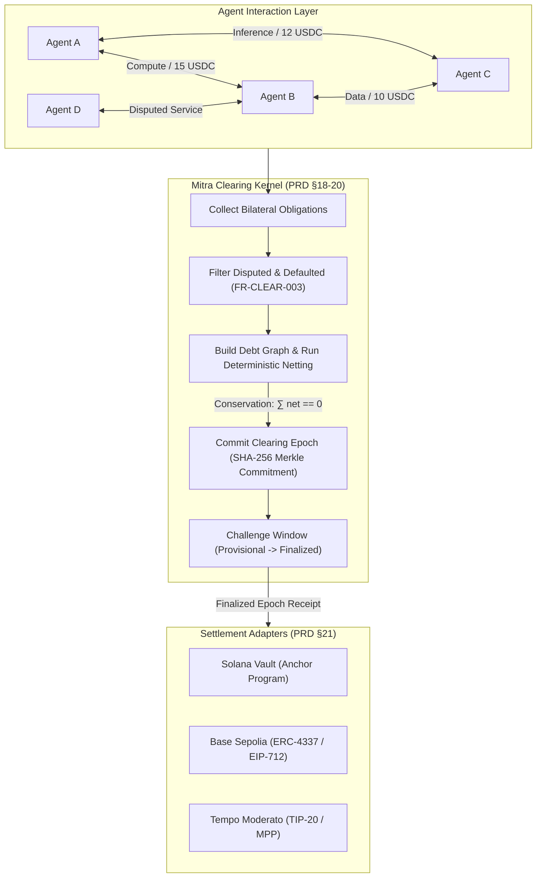

# Mitra Showcases: Project Prometheus & Project Pando
## Conceptual & Architectural Design Specification

---

### Executive Overview

Mitra is the coordination, netting, clearing, saga, and vault system for agentic commerce. Its central invariant is:

$$\text{An ALLOW decision is never itself permission to move value.}$$

```
HOW MUCH MAY I SPEND  →  WHO AUTHORIZED IT  →  MAY THIS EXACT INSTRUCTION MOVE CAPITAL
       Mandate                Policy Engine                   Execution Guard
```

To demonstrate Mitra's capabilities for the **Colosseum Hackathon (`crypto-worlds-fair`)**, we establish two complementary showcases:

```
┌────────────────────────────────────────────────────────────────────────┐
│                   MITRA ECONOMIC COORDINATION LAYER                    │
├───────────────────────────────────┬────────────────────────────────────┤
│         PROJECT PROMETHEUS        │           PROJECT PANDO            │
│         (Vertical Showcase)       │        (Horizontal Showcase)       │
├───────────────────────────────────┼────────────────────────────────────┤
│ • Autonomous Agency & Execution   │ • Multi-Agent Market Mesh          │
│ • Guarded Spend & Velocity Limits │ • Bilateral Obligation Graph       │
│ • Commercial Agreement Escrow     │ • Deterministic Netting (∑ net = 0)│
│ • TALOS Saga Failure & Refund     │ • Multi-Rail Settlement (Solana,   │
│ • ERC-8004 Economic Provenance    │   Base ERC-4337, Tempo TIP-20)     │
└───────────────────────────────────┴────────────────────────────────────┘
```

---

## 1. Project Prometheus (Vertical Showcase: Autonomous Agency)

### 1.1 Objective & Thesis
Autonomous AI agents executing complex multi-step tasks cannot operate with unchecked wallet keys. Unconstrained keys lead to catastrophic capital loss upon hallucination, infinite tool loops, or prompt injection.

**Prometheus** demonstrates an end-to-end autonomous research and procurement agent that operates in real markets with strict economic safety bounds:
1. **Never holds private keys with raw transfer authority.**
2. **Operates under time-bounded, velocity-capped mandates.**
3. **Locks escrow into commercial agreements that require deliverable verification.**
4. **Recovers automatically via TALOS Sagas on deliverable rejection, releasing locked escrow without human intervention or exceptions.**

### 1.2 Prometheus Architecture & Component Flow



### 1.3 Key Invariants Discharged by Prometheus
- **PRD §4.5 / Invariant IV:** *"Failure is a state transition, not an exception."* (Proven by [`lib/kernel/commerce-recovery.ts`](../lib/kernel/commerce-recovery.ts)).
- **FR-VAULT-004:** *"Reservations prevent aggregate overspend under concurrency."*
- **FR-COM-001:** *"Commercial terms distinct from payment transport."*
- **Capital Ordering Guarantee:** Committed capital is released *before* the saga marks terminal `RECOVERED`, ensuring no unrecorded capital movement occurs.

---

## 2. Project Pando (Horizontal Showcase: Netting & Clearing)

### 2.1 Objective & Thesis
In an economy of millions of autonomous agents exchanging inference, compute, storage, and data, executing on-chain transfers for every bilateral interaction causes extreme gas friction, chain congestion, and capital lockup.

**Pando** models a decentralized agent marketplace where bilateral obligations are continuously aggregated, topologically netted, and cleared in discrete epochs:
1. **$N$-party circular debt elimination** reduces gross transfer volume by 70–90%.
2. **Value Conservation:** Mathematical guarantee that $\sum \text{net} = 0$.
3. **Dispute Isolation:** Obligations under active dispute or default are strictly excluded from the clearing graph.
4. **Multi-Rail Settlement:** Net creditors and debtors settle atomically across Solana, Base, and Tempo using canonical adapter abstractions.

### 2.2 Pando Netting & Clearing Pipeline



### 2.3 Netting Mechanics & Example
Given three agents engaged in high-frequency coordination:
* Agent $A$ owes Agent $B$: $\$50$ USDC
* Agent $B$ owes Agent $C$: $\$40$ USDC
* Agent $C$ owes Agent $A$: $\$30$ USDC

**Gross Volume:** $\$50 + \$40 + \$30 = \$120$ USDC across 3 distinct on-chain transactions.

**Pando Deterministic Netting Matrix:**
$$\text{Net}(A) = -50 + 30 = -\$20$$
$$\text{Net}(B) = +50 - 40 = +\$10$$
$$\text{Net}(C) = +40 - 30 = +\$10$$

$$\sum \text{Net} = -20 + 10 + 10 = 0$$

**Net Settled Volume:** $\$20$ USDC (an **83.3% capital and gas reduction**), requiring only a single net payment from $A$ distributed to $B$ and $C$.

---

## 3. Developer & Co-Developer Handoff Blueprint

### 3.1 What Is Already Built & Verified
* **Step 1 (Persistence):** Schema `mitra.sagas`, `EconomicRepository.saveSaga/getSaga/listSagas/updateSaga` implemented in Postgres and in-memory ledger ([`tests/saga-persistence.test.ts`](../tests/saga-persistence.test.ts)).
* **Step 2 (Layer A Coupling):** [`lib/kernel/commerce-recovery.ts`](../lib/kernel/commerce-recovery.ts) linking `fund`, `startExecution`, and `rejectDeliverable` to TALOS saga recovery.
* **Step 3 (Layer B Routes):** [`app/api/v1/sagas/route.ts`](../app/api/v1/sagas/route.ts) supporting listing, run filtering, and direct ID lookup with state decorators.
* **Network RPC Resilience:** Exponential backoff retry loop on Moderato RPC rate limits (`-32002`) in [`scripts/fund-tempo.mjs`](../scripts/fund-tempo.mjs) and [`tests/dev-scripts.test.ts`](../tests/dev-scripts.test.ts).

### 3.2 Outstanding Implementation Tracks

```
┌─────────────────────────────────────────────────────────────────────────┐
│                     REMAINING IMPLEMENTATION TRACKS                     │
├───────────────────┬─────────────────────────────────────────────────────┤
│ Track A           │ Commercial Agreement Write Surface                  │
│ (Prometheus Path) │ Implement POST /api/v1/agreements to expose open,   │
│                   │ fund, submit, accept, reject over HTTP.             │
├───────────────────┼─────────────────────────────────────────────────────┤
│ Track B           │ Clearing & Netting Epoch Execution                  │
│ (Pando Path)      │ Wire EconomicRepository netting into                │
│                   │ POST /api/v1/clearing to execute and finalize epochs│
├───────────────────┼─────────────────────────────────────────────────────┤
│ Track C           │ Live Multi-Rail Transport Drivers                   │
│ (Settlement Path) │ Connect Base Sepolia UserOp bundler transport and   │
│                   │ Tempo Moderato TIP-20 live transfer execution.      │
└───────────────────┴─────────────────────────────────────────────────────┘
```

### 3.3 Collaboration Protocol (Working Agreement)
When your partner resumes development:
1. Run `node shared-context-mcp/dist/cli.js digest` to orient against active context.
2. Before modifying code, announce intent via `shared-context-mcp say --kind progress`.
3. Never weaken tests to pass or introduce fake success paths (per `AGENTS.md` and `BUILD_FOUNDRY.md`).
4. Keep the offline test suite isolated from live RPC flakiness.
